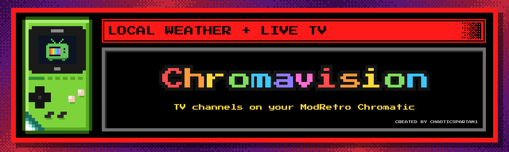
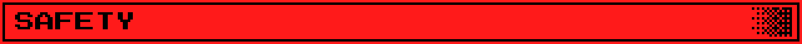
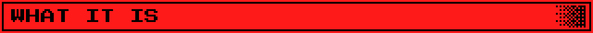
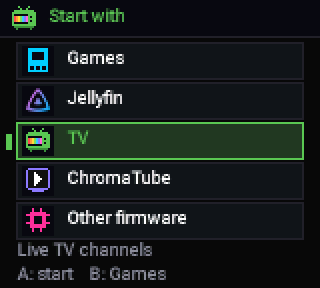
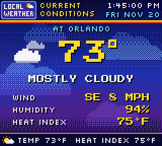
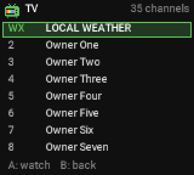
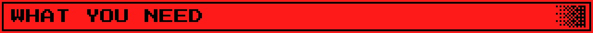
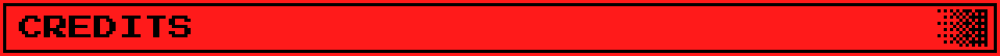

<!-- SPDX-License-Identifier: GPL-3.0-or-later -->
<p align="center">
  
</p>
<p align="center">
  The <b>TV</b> row of the Chromatic's start-up menu: a retro <b>Local Weather</b> channel drawn on the console,
  and, if you want it, <b>live TV channels</b> through your own Jellyfin server.
</p>
<p align="center">
  <b>Read the guide online:</b> <a href="https://chaoticspartan1.github.io/Chromavision/">chaoticspartan1.github.io/Chromavision</a>,
  as a PDF: <a href="docs/Chromavision-Guide.pdf">docs/Chromavision-Guide.pdf</a> (opens right on GitHub),
  or offline: download and double-click <code>Open-Documentation.html</code>.
</p>

<p><br>
</p>

## Safety

> **Chromavision is an independent project, not affiliated with ModRetro, Analogue, the Jellyfin project,
> iptv-org or the US National Weather Service.** It is not made, endorsed or supported by any of them. "ModRetro"
> and "Chromatic" are trademarks of ModRetro, Inc.; "Analogue" and "Pocket" are trademarks of Analogue;
> "Jellyfin" is a trademark of its owners; they are used here only
> to say what this project works with. **Use it at your own risk.** Support is not guaranteed.
>
> Chromavision hosts **no video and no stream addresses**. Every channel belongs to its broadcaster. The weather
> is for fun: **never use it for safety decisions**; follow official warnings.

<p><br>
</p>

## What it is

Chromavision is a separate app with its own row, **TV**, on the start-up menu of
[Jellymatic](https://github.com/ChaoticSPARTAN1/Jellymatic). It is built into Jellymatic's start-up menu, so you
install it with **Chromatic Manager**; this repository holds its guide and the PC tools for the optional Live TV part.

| Part | What it does | Needs |
|---|---|---|
| **Local Weather** (on by default) | An early-1990s cable-style local forecast loop drawn on the console: current conditions, latest observations, almanac, local and extended forecast, rain outlook or radar, with music and an announcer. | The console's Wi-Fi and the internet. **No Jellyfin server.** |
| **Live TV** (optional) | Free, official live channels you choose, converted by your Jellyfin server's Live TV into the small picture and sound the Chromatic plays. | Your Jellyfin server, set up once with Chromatic Manager (Settings › Live TV channels) or the tools here. |
| **PC tools** (this repository) | Build your own channel list, add or remove the one Live TV tuner safely, check the server, test that a channel plays in the console's format. | Python 3.10+ on a PC on the same network. |

<p align="center">
  
  
  
</p>

*All pictures are drawn by the project's own preview renderers with made-up sample data.*

<p><br>
</p>

## What you need

- A ModRetro Chromatic with Jellymatic's start-up menu **1.6.5 or newer** and its Wi-Fi set up
  ([Jellymatic guide](https://chaoticspartan1.github.io/Jellymatic/)). Sound needs Jellymatic's sound or Pocket link
  console chip image (18.40 / 18.41).
- For **Live TV** only: a Jellyfin server (10.9 or newer) on your home network that can convert video (its
  normal FFmpeg), a **normal, non-administrator** Jellyfin user for the console with Live TV allowed, and an
  administrator sign-in used **once, on the PC**, to add the tuner. Details: [What you need](docs/What-you-need.md).

<p><br>
</p>

## Quick start (plain English)

1. **Local Weather:** install or update Jellymatic's start-up menu with Chromatic Manager and choose **TV** on the
   start-up menu: it opens straight to Local Weather (Orlando, FL until you choose your place in Chromatic Manager:
   **Settings › Weather location**). [Local Weather](docs/Local-Weather.md).
2. **Live TV (optional):** easiest in Chromatic Manager: **Settings › Live TV channels** (dry run, then Add), then
   **Settings › Apps** › "Local Weather and your Jellyfin server's Live TV channels". Or by hand: build your channel list
   (`py -3 tools\make_channel_list.py --group weather --group animation`), put it where your Jellyfin server can
   read it, then check and add the tuner with a dry run first
   (`py -3 tools\livetv_tuner.py add --server-path <the list as the server sees it> --ask-admin`, then the same
   with `--yes`). Step by step: [Live TV set-up](docs/Live-TV-setup.md).
3. **Watch:** start-up menu › **TV** › a channel › **A**. Up/Down change channel; **B** goes back
   ([Using TV](docs/Using-TV.md)).

<p><br>
</p>

## Your Jellyfin server stays yours

- **Add-only:** one tuner, nothing else. No library, user, device, plugin, task or conversion setting is changed,
  and the tools prove it after every step.
- **Backup and dry run first:** the Live TV settings are saved before any change; every change is shown in full
  and sent only with `--yes`.
- **Limited:** at most 1 channel (or 2, if you choose) converted at once, so TV cannot overload the server.
- **Your other devices are never signed out.** The tools sign out only their own one-run session.
- **Private:** your server address, sign-in and channel list stay on your PC and server; nothing is uploaded,
  and the tools print counts, never addresses or names. Keep Jellyfin off the internet.

Full rules: [Server safety](docs/Server-safety.md).

<p><br>
</p>

## Undo everything

`py -3 tools\livetv_tuner.py remove --yes` deletes exactly the tuner it added and proves the Live TV settings
equal the backup. Delete your list file. On the console, hide the TV row (Select on it, or Chromatic Manager › Settings ›
Apps), or remove the start-up menu altogether. [Undo everything](docs/Undo-everything.md).

<p><br>
</p>

## Documentation (wiki)

Start at **[docs/Home.md](docs/Home.md)**. Pages: What you need · Local Weather · Live TV set-up · Choosing
channels · Using TV · Server safety · Undo everything · Troubleshooting · FAQ · Building and testing · Credits &
licences.

**As one PDF:** [docs/Chromavision-Guide.pdf](docs/Chromavision-Guide.pdf). **Offline:** download or clone this
repository and double-click **`Open-Documentation.html`** (keep it next to `docs/`). Both are built from the
Markdown pages by `scripts/build_docs_html.py` and `scripts/build_docs_pdf.py`.

<p><br>
</p>

## What is in this repository

```
tools/                  PC tools: make_channel_list.py, livetv_tuner.py, jellyfin_admin.py, tests/
docs/                   the guide (Markdown), pictures, fonts, GitHub Pages copy, PDF guide
art/                    the TV row's icons (original pixel art)
media/                  promo videos and a still picture
scripts/                documentation builders and their test
```

**Not in this repository:** the console code. The TV row, the Local Weather channel, its sound and pictures are
part of Jellymatic's start-up menu (`chromatic/weather/`, `chromatic/jellyfin/`, `chromatic/launcher/` in
[Jellymatic](https://github.com/ChaoticSPARTAN1/Jellymatic)), so there is one start-up menu to install and review.
Also not here: any channel list, stream address, logo or recording, and anything personal. Your own files (backups,
the tuner record, your list) live in `%LOCALAPPDATA%\Chromavision` and never in Git.

<p><br>
</p>

## Sibling projects

- [Jellymatic](https://github.com/ChaoticSPARTAN1/Jellymatic): the Chromatic start-up menu, Jellyfin app and Chromatic Manager (Chromavision runs inside it).
- [ChromaTube](https://github.com/ChaoticSPARTAN1/ChromaTube): the optional video-channel row, also through Jellyfin.
- [PocketFin](https://github.com/ChaoticSPARTAN1/PocketFin): Jellyfin on the Analogue Pocket.
- [RemotePilot](https://github.com/ChaoticSPARTAN1/RemotePilot): see and press the console's menus from your PC.

<p><br>
</p>

## Licence

Chromavision is free software: **GPL-3.0-or-later** ([LICENSE](LICENSE)), with additional terms under GPLv3
section 7 ([ADDITIONAL-TERMS.md](ADDITIONAL-TERMS.md)): keep the author attribution "ChaoticSPARTAN1" (7(b)) and mark
modified versions as modified (7(c)). Parts made by others keep their own licences; see [NOTICE](NOTICE),
[THIRD-PARTY-NOTICES.md](THIRD-PARTY-NOTICES.md) and [Credits & licences](docs/Credits-and-licences.md).

<p><br>
</p>

## Contributing and security

Pull requests, bug fixes and bug reports are welcome: [CONTRIBUTING.md](CONTRIBUTING.md). To report a security
problem privately: [SECURITY.md](SECURITY.md). Never post server addresses, tokens, channel lists tied to you, your
weather location or logs with addresses.

<p><br>
</p>

## Credits

Created by **ChaoticSPARTAN1**. Weather data from the US National Weather Service (public domain). Channel data from
[iptv-org](https://github.com/iptv-org) (The Unlicense; the streams belong to their broadcasters). Place look-up from
the US Census Bureau Gazetteer (public domain). Announcer lines made with Piper and its public-domain "Norman"
voice. Full list: [Credits & licences](docs/Credits-and-licences.md).
