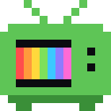
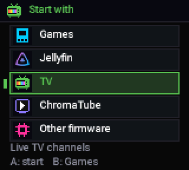
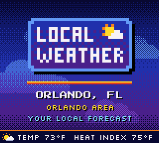

<!-- SPDX-License-Identifier: GPL-3.0-or-later -->
<p align="center"></p>
<p align="center"></p>

# Chromavision wiki

**TV on your ModRetro Chromatic**: a retro Local Weather channel drawn on the console, and, if you want it, live
channels through your own Jellyfin server.

**Read it as one PDF:** [Chromavision-Guide.pdf](Chromavision-Guide.pdf) (opens right on GitHub). **Or offline:**
download or clone the repository, then double-click `Open-Documentation.html` in its main folder.

> Chromavision is an independent project, not affiliated with ModRetro, Analogue, the Jellyfin project, iptv-org
> or the US National Weather Service. Use it at your own risk; support is not guaranteed. The weather is for fun: never use it
> for safety decisions.

## Contents

| Page | Read it when |
|---|---|
| [What you need](What-you-need.md) | Before anything else |
| [Local Weather](Local-Weather.md) | You want the weather channel and your own location |
| [Live TV set-up](Live-TV-setup.md) | You want live channels through your Jellyfin server |
| [Choosing channels](Choosing-channels.md) | You build or change your channel list |
| [Using TV](Using-TV.md) | Buttons and what the screens say |
| [Server safety](Server-safety.md) | You want to know exactly what the tools do to your server |
| [Undo everything](Undo-everything.md) | You want it all gone |
| [Troubleshooting](Troubleshooting.md) | Something does not work |
| [FAQ](FAQ.md) | Short answers |
| [Building and testing](Building-and-testing.md) | You change the tools or the docs |
| [Credits & licences](Credits-and-licences.md) | Who made what, and under which licence |

## In one picture

```
 Start-up menu ──► TV ──► Local Weather ........ drawn on the console from US weather data (the default; no server)
                    └──► with Live TV: a list ── WX LOCAL WEATHER, then your channels, converted by your Jellyfin server

 PC (once): Chromatic Manager › Settings › Live TV channels   (or by hand: make_channel_list.py ──► livetv_tuner.py add)
```

<p align="center">
</p>

The TV row is part of [Jellymatic](https://github.com/ChaoticSPARTAN1/Jellymatic)'s start-up menu: Chromatic
Manager installs it, and it can be hidden there (Settings › Apps) or on the console (Select on its row). This repository holds the guide and the PC
tools for the optional Live TV part.
