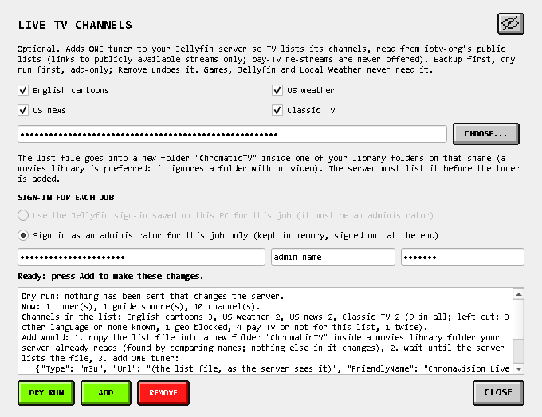

<!-- SPDX-License-Identifier: GPL-3.0-or-later -->
# Live TV set-up

[Home](Home.md) › Live TV set-up

**Contents:** [How it works](#how-it-works) · [1. Prepare Jellyfin](#1-prepare-jellyfin) ·
[2. Get the tools](#2-get-the-tools) · [3. Build your channel list](#3-build-your-channel-list) ·
[4. Put the list where the server can read it](#4-put-the-list-where-the-server-can-read-it) ·
[5. Check the server](#5-check-the-server) · [6. Optional: a trial](#6-optional-a-trial) ·
[7. Add the tuner](#7-add-the-tuner) · [8. Watch](#8-watch) · [Change your channels](#change-your-channels)

Live TV is **optional**. Local Weather works without any of this.

**The easy way: Chromatic Manager.** **Settings › Live TV channels** (text menu `l`): tick channel groups (English
cartoons, US weather, US news, classic TV), choose the folder on your PC that holds your Jellyfin library folders,
sign in as an administrator for that one job, **Dry run**, then **Add** and **Approve**. Then **Settings › Apps** ›
"Local Weather and your Jellyfin server's Live TV channels". It adds the same one tuner, under the same name, with the
same rules (allowing 2 channels at once), and **Remove** undoes it.

<p align="center"></p>

**By hand, with the tools here**, for your own choice of channels and stream limit: the steps below. The tools and
Chromatic Manager recognise each other's tuner, so either one's **Remove** works, and neither adds a second tuner.

## How it works

The Chromatic cannot decode the channels' own video (H.264). Your Jellyfin server's built-in **Live TV** feature
reads a channel list (an `.m3u` file) as a "tuner", and converts the channel you watch into the small MJPEG picture
and ADPCM sound the Chromatic already plays, exactly as it does for films. The console asks for at most 400 kbit/s
and one stream at a time; the tuner allows at most 1 (or 2) channels converted at once.

```
 broadcasters' free streams ──► your Jellyfin server (Live TV tuner + conversion) ──Wi-Fi──► Chromatic, TV row
                                        ▲
                        your channel list file (made on your PC, kept on your server)
```

## 1. Prepare Jellyfin

1. Keep the server on your **home network only** ([Server safety](Server-safety.md)).
2. Check that conversion works: **Dashboard › Playback › Transcoding** (the default settings are fine).
3. Make or choose a **normal user for the console** (not an administrator): **Dashboard › Users**. In that user's
   settings turn on **Allow Live TV access**. Give it only the libraries you want on the console.
4. Sign the console in **as that user**: on the console, Jellyfin › **Select** › Jellyfin server; approve its
   Quick Connect code in a Jellyfin app where you are signed in as that user.

## 2. Get the tools

1. Install **Python 3.10 or newer** (python.org). Nothing else is needed.
2. Download this repository (Code › Download ZIP, or `git clone`) and unzip it.
3. Open a terminal in the repository folder. The commands below use `py -3` (Windows); on macOS or Linux use
   `python3`.

The tools sign in with an administrator **only when you ask them to** (`--ask-admin`): they ask for the name and
password, keep them in memory for that one run, and sign that run's own session out at the end. Nothing is saved.
Without `--ask-admin` they use the Jellyfin settings saved for Chromatic Manager (or
`%LOCALAPPDATA%\Chromavision\jellyfin-connection.txt`, see `jellyfin-connection.example.txt`), which is fine for
the read-only `check` and `status`.

## 3. Build your channel list

```
py -3 tools\make_channel_list.py --list-groups
py -3 tools\make_channel_list.py --group weather --group animation --group classic
```

It reads the public iptv-org data, keeps only the channels that pass every rule (English, not geo-blocked, no
pay-TV re-streams, no bare IP addresses, and more: [Choosing channels](Choosing-channels.md)) and writes
`channels.m3u` to your private folder (`%LOCALAPPDATA%\Chromavision\`). Add `--pick` to choose single channels.

## 4. Put the list where the server can read it

The tuner reads the file **as the server sees it**. Copy `channels.m3u` into a folder the Jellyfin server can read,
outside your media libraries, and note the path the **server** uses for it (Chromatic Manager's own set-up does it
differently: it puts the list in a new folder "ChromaticTV" inside one of your library folders, which the server
already sees; both work):

| Jellyfin runs | Copy the file to | The server path (`--server-path`) |
|---|---|---|
| in Docker, with its configuration folder mounted at `/config` | `<the host folder mounted as /config>/chromavision/channels.m3u` | `/config/chromavision/channels.m3u` |
| as a Windows service | `C:\ProgramData\Jellyfin\Server\chromavision\channels.m3u` | the same path |
| from the Linux package | `/var/lib/jellyfin/chromavision/channels.m3u` (readable by the `jellyfin` user) | the same path |

Only folders that are mounted into a Jellyfin container are visible to it: a file elsewhere on the same disk is not.
The tool checks, read-only, that the server lists the file before it adds anything.

## 5. Check the server

```
py -3 tools\livetv_tuner.py check --ask-admin
```

Read-only. It says whether the version is new enough, whether Live TV settings can be read, how many tuners and
channels there are, and saves a backup of the Live TV settings in your private folder. **Nothing is changed.**

## 6. Optional: a trial

Build a small trial list with the same rules as your real one, put it where the server can read it (step 4), then:

```
py -3 tools\make_channel_list.py --group weather --max 3 --out <a folder outside the repository>\trial.m3u
py -3 tools\livetv_tuner.py trial --server-path /config/chromavision/trial.m3u --yes --ask-admin
```

It adds a **temporary** tuner reading that list (one stream at most), plays one channel for
20 seconds in the Chromatic's format, closes it, **deletes the tuner** and proves the Live TV settings and the rest
of the server are exactly as before. Use it to see that your server can convert live channels before you add your
own list. Its test channels leave the list at the next guide refresh.

## 7. Add the tuner

```
py -3 tools\livetv_tuner.py add --server-path /config/chromavision/channels.m3u --ask-admin
```

A **dry run**: it checks the server sees the file and shows exactly what it would add (one tuner, its name, its
stream limit). Nothing is sent. When it looks right, run it again with `--yes`:

```
py -3 tools\livetv_tuner.py add --server-path /config/chromavision/channels.m3u --yes --ask-admin
py -3 tools\livetv_tuner.py refresh-guide --yes --ask-admin
```

`add --yes` saves a backup, adds the one tuner named "Chromavision Live TV (added by Chromavision tools)", records
its id in your private folder, and proves nothing else changed. `--streams 2` allows two channels at once (for
example the console and one other screen); the default is 1. `refresh-guide` runs Jellyfin's own guide refresh
once so the channels appear at once.

## 8. Watch

Turn the list on for the console: Chromatic Manager › **Settings › Apps** › "Local Weather and your Jellyfin server's
Live TV channels" (with Local Weather only, TV opens straight to the weather). Then start-up menu › **TV**: your
channels are listed under the Local Weather row. Highlight one and press **A**
([Using TV](Using-TV.md)).

## Change your channels

Build the list again (step 3), copy it over the old file (step 4, same path), then
`py -3 tools\livetv_tuner.py refresh-guide --yes --ask-admin`. The tuner itself stays as it is.

Next: [Choosing channels](Choosing-channels.md)
