<!-- SPDX-License-Identifier: GPL-3.0-or-later -->
# Local Weather

[Home](Home.md) › Local Weather

**Contents:** [What it is](#what-it-is) · [Open it](#open-it) · [The pages](#the-pages) ·
[Choose your location](#choose-your-location) · [Location packs](#your-areas-map-and-radar-pages-a-location-pack) · [Sound](#sound) · [Where the data comes from](#where-the-data-comes-from) ·
[Privacy](#privacy) · [Limits](#limits)

## What it is

**Local Weather** (shown as **WX LOCAL WEATHER**) is a channel drawn by the console itself: an
early-1990s cable-style "local forecast" loop at 160 × 144 pixels, with our own art, fonts, music and announcer.
It needs Wi-Fi and the internet, **not** a Jellyfin server, so it works even when your server is off.

> For fun only. **Never use it for safety decisions**: follow official warnings from the National Weather
> Service and your local authorities.

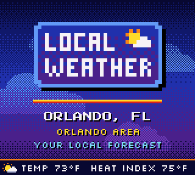
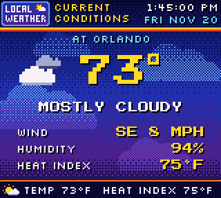
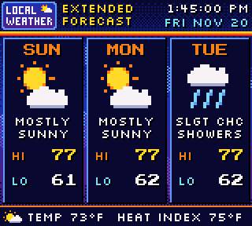

*The pictures show the built-in example place, Orlando, FL, drawn by the project's preview renderer from a
recorded set of weather replies.*

## Open it

- **TV with Local Weather only** (the default): start-up menu › **TV** › **A** opens Local Weather straight away, once
  Wi-Fi has joined. No Jellyfin server or sign-in is needed. **B** returns to the start-up menu.
- **TV with Live TV channels** (Chromatic Manager › Settings › Apps): **TV** opens the channel list; **WX LOCAL
  WEATHER** is its first row. There **B** returns to the list and **Up** / **Down** go to the first / last TV channel.

The pages turn by themselves (about 8 seconds each); a banner shows the keys for 3 seconds. If the channel cannot
open, the screen says **Local Weather did not open** with the reason; **B** returns.

The first time, the pages show `--` and **UPDATING** while the data arrives (a second or two on a good network,
longer on a slow one). Values are kept until the console is switched off, so coming back is quicker.

## The pages

| Page | What it shows |
|---|---|
| Opening card | The channel badge, your place's name |
| Current Conditions (2 pages) | Temperature, sky, wind, humidity, dew point, pressure, visibility, ceiling, feels-like |
| Latest Observations | Nearby weather stations: temperature, sky, wind |
| Today's Almanac | Sunrise, sunset, moon phase and the next four phases, worked out on the console |
| Local Forecast | The forecast text, one page per period |
| Extended Forecast (2 pages) | Six days: icon, high, low, chance of rain |
| Regional Forecast (2 pages) | Today's highs on a state map and a close-up of the area, where offered (see [Limits](#limits)) |
| Current Radar, or Rain Outlook | The radar picture with a light-to-heavy key where offered; otherwise the chance of rain for each coming period |

A ticker at the bottom rolls through the latest figures. When the National Weather Service has an **active alert**
for your place, the bar turns red, the headline crawls across it and an alert tone plays with the opening card.

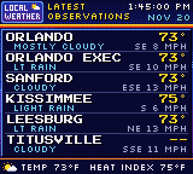
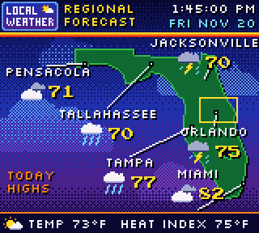
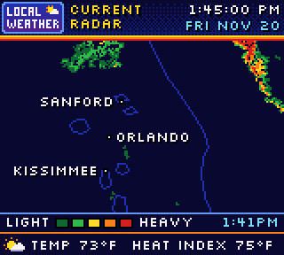

All pages of one loop, for Orlando, FL:

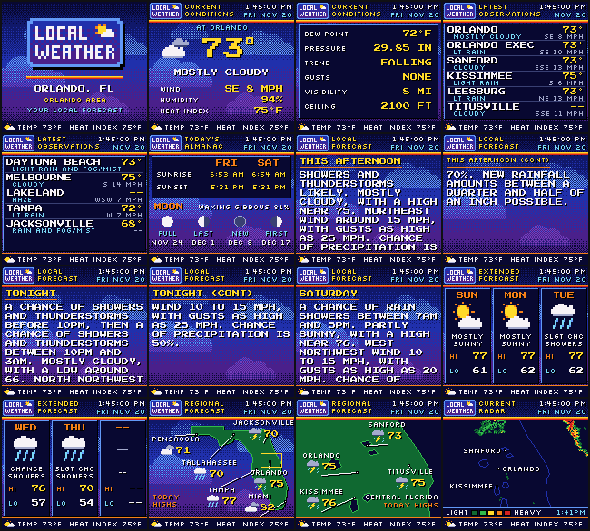

If the console has no Wi-Fi yet, TV says so and offers to set it up right there:

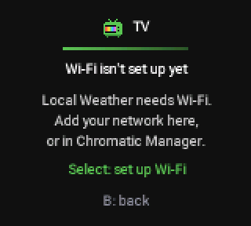

## Choose your location

Your place is chosen on the PC, in **Chromatic Manager** (part of Jellymatic), and written to the console:

1. Connect the console with the USB cable, switch it on and open Chromatic Manager.
2. **Settings › Weather location**. Type a US **ZIP code** (for example `32801`) or **City, ST** (for example
   `Orlando, FL`) and press **Find**. The match comes from a table on your PC: nothing is sent yet.
3. Choose the place. The Manager then asks the National Weather Service (and only it) for the forecast area, time
   zone and six nearest weather stations, and shows them.
4. Press **Save and write to console** and **Approve**. The place goes into two small records of its own on the
   console (your Wi-Fi and Jellyfin set-up are not touched), checked on the chip.

Until you choose a place the channel shows the built-in default, **Orlando, FL**. **Use default (Orlando, FL)** erases
your place (and its area pages) again. Installing, updating or switching off the start-up menu keeps your place; removing the menu erases it
(Chromatic Manager keeps its copy and writes it back at the next install).

### Your area's map and radar pages: a location pack

On its own, a place gets its conditions, forecasts, almanac and nearby stations, with a **Rain Outlook** page where
the map and radar pages would be (a place in Florida keeps the built-in Florida map pages, and the radar near
Orlando). For your own area's maps and radar, add its **area pages**, a "location pack" (start-up menu 1.6.5 or
newer):

1. In **Settings › Weather location**, after choosing your place, press **Make the area pages**. Chromatic Manager asks
   the National Weather Service about the towns near your place (about a minute; for the chosen area only) and makes a
   small pack (a few KB) with:
   - **Regional Forecast**: your state's outline with today's highs for your place and up to five larger towns;
   - a **close-up** of your area with nearby towns;
   - **Current Radar**: the nearest weather service radar, around your place, with town labels.
2. A preview of every weather page, drawn by the console's own drawing code, appears in the window (hidden while
   private details are hidden; the figures show `--` until the console fetches them).
3. **Save and write to console**, then **Approve**: the place and its pages are written together and checked. They
   stay through updates of the start-up menu; **Use default (Orlando, FL)** removes both.

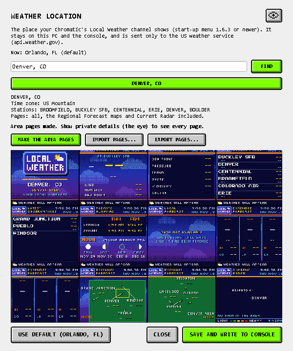

The pages a pack gives Orlando, FL (the built-in place, made here by the tool as an example; the figures appear when
the console fetches them):

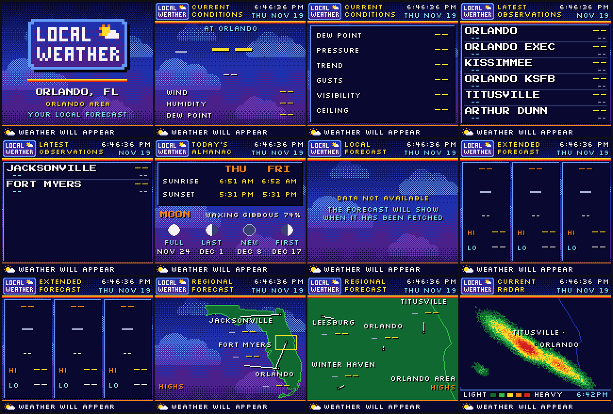

**Sharing pack files.** **Export pages...** saves the pack as a `.pjlp` file; **Import pages...** uses one, for the same
place only. A pack file names its place: share it only if you want to. Chromatic Manager and the console check every
pack in full and ignore a damaged one (the console then shows the place without the map and radar pages), but **only
import packs from people you trust**. Without the window: `py -3 scripts\make_location_pack.py "Orlando, FL" orlando.pjlp`
(in Jellymatic's `scripts/`) makes the same file (Python 3 and a connection to the US weather service only).

The map pages are made by a program, not drawn by hand, so a crowded state can show fewer towns than Orlando's built-in
pages; town names and state outlines come from US Census Bureau data bundled with Jellymatic (public domain).

### The first install asks

When Chromatic Manager installs the start-up menu on a console for the first time, it asks **Add Local Weather?**
before the install's **Approve**: **Choose my place...** (a ZIP code or "City, ST", then it offers to make the area
pages), **Use Orlando, FL**, or **Skip Local Weather** (the TV row stays hidden; turn it on any time in Settings ›
Apps). Your answer is written by that same install, which says what it will write first. Updates do not ask again.

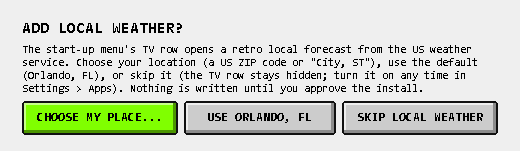

## Sound

With Jellymatic's sound or Pocket link console chip image (18.40 / 18.41), the channel plays a looping music
track written for this project, an announcer line at the start of each section ("Your current conditions.",
"Your local forecast.", "Your extended forecast.", "Your regional forecast.", "Current radar.") and the alert
tone. The announcer lines were made with the open-source speech tool Piper and its "Norman" voice, which was
trained only on public-domain recordings ([Credits & licences](Credits-and-licences.md)). With the official console
chip image the channel is silent.

## Where the data comes from

- **US National Weather Service**, `https://api.weather.gov`: observations, forecasts, alerts. Free, no key, public
  domain. The console identifies itself with a plain program name, nothing personal.
- **Radar picture**, where offered: the National Weather Service's map server (`opengeo.ncep.noaa.gov`).
- **Clock**: the public time service `pool.ntp.org`; if it does not answer, the time of the weather service's reply.
- Sun and moon times are worked out on the console, not fetched.
- The place look-up table, the state outlines and the town list for location packs come from the **US Census Bureau**
  (2024 Gazetteer files and the 20M cartographic boundary file; public domain), bundled with Jellymatic: looking a
  place up sends nothing anywhere.

## Privacy

- Your place is kept **only on your PC and your console**. It is sent only to the National Weather Service (as
  map coordinates and the station and forecast-area codes of your place). Making area pages asks it about the chosen
  area only, and checks one radar picture on its map server.
- A pack file (`.pjlp`) names its place: share it only if you want to, and import only packs you trust (every pack is
  checked in full before use). It never goes into Git, logs or
  screenshots: Chromatic Manager says "your location", never the place.
- The console checks the weather servers' certificates and names. It does not check certificate dates (it has no
  clock when it starts).
- Nothing about what you watch is sent anywhere.

## Limits

- **US places only** (the National Weather Service covers the US and its territories).
- The **Current Radar** page and the two **Regional Forecast** maps come from the built-in Orlando area (a place in
  Florida keeps the Florida maps and the radar near Orlando) or from your place's **location pack**; for a place without
  a pack the channel shows the **Rain Outlook** page instead.
- A location pack's maps are laid out by a program: a crowded state may show fewer towns than the built-in Orlando pages.
- The channel runs only while it is on screen; it is not refreshed in the background.
- An observation older than 4 hours, or a forecast older than 12 hours, is not shown.
- Station names are shortened to fit the screen.

Next: [Live TV set-up](Live-TV-setup.md)
