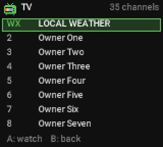
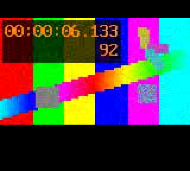
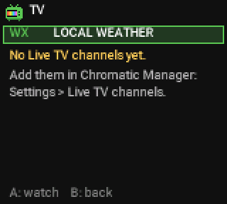
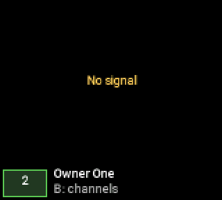

<!-- SPDX-License-Identifier: GPL-3.0-or-later -->
# Using TV

[Home](Home.md) › Using TV

**Contents:** [The channel list](#the-channel-list) · [Watching](#watching) · [What the screen says](#what-the-screen-says) ·
[Leaving](#leaving) · [Limits](#limits)

## The channel list

With Live TV turned on (Chromatic Manager › Settings › Apps), start-up menu › **TV** › **A** opens the list at once:
**WX LOCAL WEATHER** first, then your server's Live TV channels, seven to a page, with number and name. (With Local
Weather only, TV opens straight to the weather.)

| Button | Does |
|---|---|
| **Up / Down** | Move (wraps round, pages turn by themselves) |
| **A** | Watch the highlighted channel |
| **B** | Back to the start-up menu |
| **Select** (on the start-up menu's TV row) | Asks "Hide TV?" (bring it back: Other firmware › Show hidden apps) |

If the server or its Live TV does not answer, the list still shows the weather row, a **Try again** row and the
reason. **Select** finds the server again or signs in again, as on the Jellyfin page. If the server has no Live TV
channels yet, the list says **No Live TV channels yet** under the weather row.

## Watching

| Button | Does |
|---|---|
| **Up** / **Down** | Next / previous channel. The channel starts 1.5 seconds after your last press, so you can skip through |
| **A**, **Start** or **Select** | Show the channel's number and name again |
| **B** | Back to the channel list |

Tuning takes a few seconds: your server opens the channel and starts converting it. A channel closed less than
10 seconds ago is opened again only after those 10 seconds (it gives the server time to clean up). There is no
pause and no rewind: it is live.

If the network is too slow for two 5-second stretches in a row, the console closes the channel and tunes it once
more at a lower quality ("Adjusting quality..."). The next channel starts at the normal quality again.

## What the screen says

| Message | Means |
|---|---|
| **Opening TV...** | The app is starting |
| **No signal** | The channel refused, ended, or sent no picture for 20 seconds. Many free channels come and go; try another one |
| **The server did not answer** | No answer within 30 seconds: is the server on? |
| **Adjusting quality...** | The console is reopening the channel at a lower quality |

## Leaving

Every way out (B, another channel, the weather row, Games) closes the stream on the server: the console stops its
conversion and closes the live channel before it does anything else. If the console is switched off while a channel
plays, the server notices within about 10 seconds and cleans up by itself.

## Limits

- One channel at a time; no guide (programme titles) yet; long names are cut.
- No watch history is written for channels.
- Sound needs Jellymatic's console chip image 18.40 or 18.41.
- TV and Local Weather are on the Chromatic only, not on the Analogue Pocket.

Next: [Server safety](Server-safety.md)
